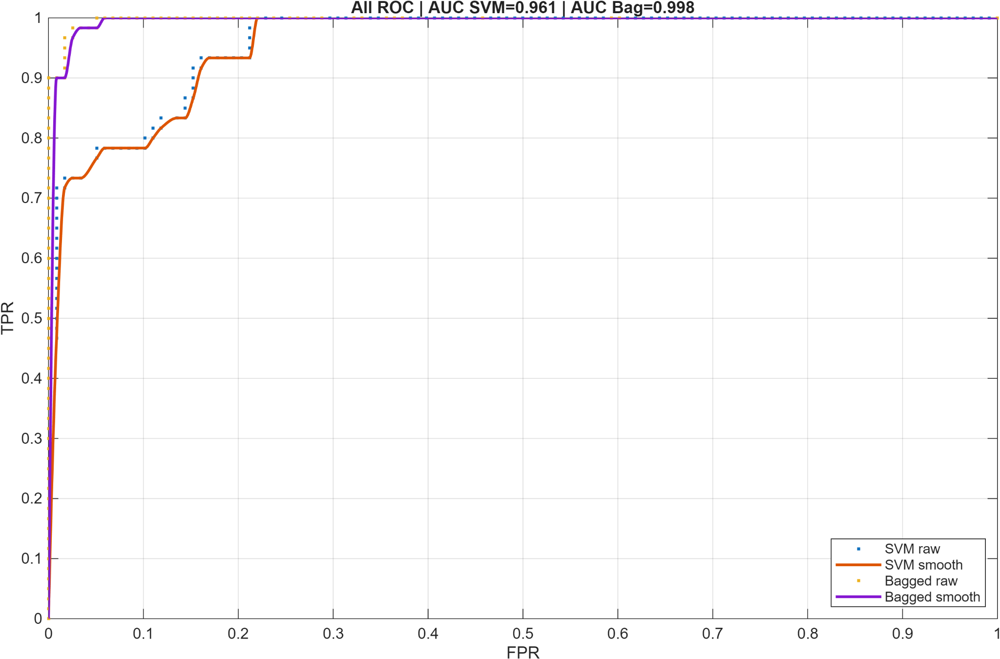
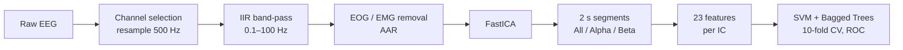

# Parkinson's Disease Detection from Resting-State EEG using Higher-Order Statistics

A full MATLAB re-implementation of the study *"Diagnosis of Parkinson's disease using higher order statistical analysis of alpha and beta rhythms"*: EEG preprocessing, ICA, nonlinear-dynamics and bispectral feature extraction, and SVM / ensemble classification.

Biomedical signal processing course project, Ariel University. Team of two: Asaf Refael Dabush and Avichai Shiachi.

---

## Results

Resting-state EEG, OFF medication, **56 subjects** (Parkinson's vs. healthy controls), 20 non-overlapping 2 s segments per subject (1,120 segments per band). 10-fold cross-validation.

| Band | Classifier | Accuracy | Sensitivity | Specificity | AUC |
|---|---|---|---|---|---|
| **All (0.1–100 Hz)** | **Bagged Trees** | **93.82 %** | **100 %** | 90.68 % | **0.998** |
| All | SVM (RBF) | 87.64 % | 78.33 % | 92.37 % | 0.961 |
| Alpha (8–12 Hz) | Bagged Trees | 88.89 % | 100 % | 83.33 % | 0.933 |
| Alpha | SVM (RBF) | 81.67 % | 58.33 % | 93.33 % | 0.885 |
| Beta (13–30 Hz) | Bagged Trees | 88.89 % | 100 % | 83.33 % | 0.975 |
| Beta | SVM (RBF) | 80.56 % | 55.00 % | 93.33 % | 0.907 |

  

The full-band features with an ensemble classifier performed best, which points to cross-frequency interactions carrying diagnostic information that isolated alpha or beta bands lose.

## Pipeline

### Features (23 per independent component, no channel averaging)

| Group | Features |
|---|---|
| Nonlinear dynamics | Largest Lyapunov exponent (Rosenstein), Hurst exponent (R/S), approximate entropy, correlation dimension (Grassberger–Procaccia) |
| Higher-order moments | Normalised central moments of order 3 to 8 |
| Bispectrum / bicepstrum | H1–H5, BH1–BH5 and bispectral entropies BE1, BE2, BEp |

## Code

| Script | Purpose |
|---|---|
| [`matlab/preprocessing.m`](matlab/preprocessing.m) | Resampling, filtering, AAR artefact removal, FastICA, segmentation, saves EEGLAB `.set` per band |
| [`matlab/feature_extraction_hos.m`](matlab/feature_extraction_hos.m) | Nonlinear and higher-order spectral features per IC segment, written to CSV |
| [`matlab/classification_kfold.m`](matlab/classification_kfold.m) | SVM and Bagged Trees, 10-fold CV, metrics and ROC curves |

Requirements: MATLAB with the Statistics and Machine Learning, Signal Processing and Parallel Computing toolboxes, and EEGLAB with the AAR plug-in. Place the dataset under `data/PD REST/` and run the three scripts in order. The raw EEG data are not included.

## Limitations

- Cross-validation is performed at the **segment level**. Segments from the same subject can fall in both the training and test folds, so the reported figures are optimistic for unseen patients. A leave-subject-out evaluation is the natural next step.
- 56 subjects is a small cohort; the results replicate the paper's method, not a clinical validation.

## Documentation

[`docs/Project_Summary_HE.pdf`](docs/Project_Summary_HE.pdf): methodology, feature definitions and results (Hebrew).
